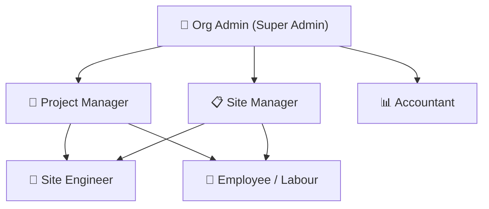

# BuildSphere: Role-Based Access Control (RBAC) Specification & Security Guide

This document defines the Role-Based Access Control (RBAC) architecture, module access boundaries, and operational permissions for the **BuildSphere Construction Management Platform**.

---

## 1. System Role Hierarchy

The platform categorizes users into five distinct operational tiers:



- **Tier 1 (Executive & Governance)**: Org Admin
- **Tier 2 (Operational Leadership)**: Project Manager, Site Manager
- **Tier 3 (Specialized Operations)**: Accountant (Financials), Site Engineer (Field Engineering)
- **Tier 4 (Field Workforce)**: Employee / Labour (Self-Service)

---

## 2. Master Module Access Matrix

The table below outlines screen visibility and action capabilities across all platform modules:

| Platform Module | Org Admin | Project Mgr | Site Mgr | Site Eng | Accountant | Labour / Emp |
| :--- | :---: | :---: | :---: | :---: | :---: | :---: |
| **Dashboard (KPIs & Telemetry)** | Full Access | Full Access | Full Access | Hidden | View-Only | Hidden |
| **Projects Management** | Full (CRUD) | Full (Create/Edit) | Full (Create/Edit) | View-Only | View-Only | Hidden |
| **Workforce & Employees** | Full (Manage/Wages) | Full (Manage/Assign) | Full (Manage/Assign) | View List | Wage Audit | Hidden |
| **Attendance Register & Reports** | Full (Mark/Edit/All) | Full (Mark/Edit/All) | Full (Mark/Edit/All) | View/Mark | Reports Only | **Personal View Only** |
| **Work Management (DPR & Tasks)** | Full Access | Full Access | Full Access | Full Access | Hidden | Hidden |
| **Spend & Vendors** | Full (Approve & Log) | Full (Log & Bills) | Full (Log & Bills) | Running Cost | Full (Invoices/Ledger) | Hidden |
| **Payment Central** | **Final Approval & Pay** | Request Only | Request Only | Hidden | Prepare Vouchers | Hidden |
| **Upad (Worker Advances)** | **Approve, Disburse, Delete** | Request & Record | Request & Record | Hidden | Ledger & Settle | **Personal View / Request** |
| **Payroll & Wages** | **Final Payout Release** | View & Compute | View & Compute | Hidden | Full (Compute/Export) | **Personal Payslips Only** |
| **Financial Ledger (GL)** | Full Access | Hidden | Hidden | Hidden | Full Access | Hidden |
| **Reports & Data Exports** | All Reports | Site Reports | Site Reports | Hidden | Financial Reports | Hidden |
| **Cost Estimator & BOQ** | Full Access | Full Access | Full Access | Full Access | Rate Reference | Hidden |
| **Settings & Invitations** | **Exclusive Access** | Forbidden | Forbidden | Forbidden | Forbidden | Forbidden |
| **System Audit Logs** | **Exclusive Access** | Forbidden | Forbidden | Forbidden | Forbidden | Forbidden |

---

## 3. Granular Role Profiles

### 👑 Org Admin (`ORG_ADMIN`)
> **Note**: The Organization Administrator holds complete sovereignty over tenant data, user provisioning, and company-level financial disbursements.

* **Primary Capabilities:**
  * **Tenant Management**: Update organization profile, workday duration (e.g. 8.00 hrs), half-day thresholds (4.00 hrs), and overtime rules.
  * **Team Provisioning**: Invite users via email tokens, assign roles, deactivate accounts, and manage seat licenses.
  * **Financial Authority**: Exclusive authority to approve payments in **Payment Central**, disburse **Payroll**, and approve/delete **Upad advances**.
  * **Compliance & Auditing**: Review immutable system audit logs for forensic event tracking.
* **Access Scope**: Unrestricted across all 12 platform modules.

---

### 👷 Project Manager (`PROJECT_MANAGER`) & Site Manager (`SITE_MANAGER`)
> **Note**: Project Managers and Site Managers share identical operational authority over construction sites, personnel allocation, and daily activity tracking.

* **Primary Capabilities:**
  * **Project Execution**: Create and edit project profiles, timelines, budgets, and client details.
  * **Workforce Deployment**: Add workers, configure daily wages, and assign personnel to specific project sites.
  * **Attendance Administration**: Mark daily attendance records (Full Day, Half Day, Overtime, Absent) and generate attendance summaries.
  * **DPR & Site Progress**: Record daily tasks, worker gang allocations, and progress percentages.
  * **Procurement Logging**: Log vendor invoices, site expenses, and daily running costs.
  * **Advance Requests**: Submit Upad requests on behalf of workers for admin settlement.
  * **Cost Estimation**: Run the AI Cost Estimator and generate client BOQ PDF quotations.
* **Restrictions:**
  * Cannot access **Organization Settings** or issue tenant team invitations.
  * Cannot access the double-entry **Financial General Ledger**.
  * Cannot perform final company bank account disbursements without Org Admin sign-off.

---

### 📐 Site Engineer (`SITE_ENGINEER`)
* **Primary Capabilities:**
  * View assigned projects and active project milestones.
  * Enter and update Daily Progress Reports (DPR) and task tracking.
  * Record minor on-site petty cash and operational running costs.
  * Generate baseline Bill of Quantities (BOQ) estimates.
* **Restrictions:**
  * Cannot edit employee master salary wages.
  * Cannot access Payment Central, Payroll, or Financial Ledger.
  * Cannot access system configuration or user administration.

---

### 📊 Accountant (`ACCOUNTANT`)
* **Primary Capabilities:**
  * **General Ledger**: Manage Chart of Accounts, manual Journal Entries, and Trial Balance reports.
  * **Payroll Administration**: Compute monthly worker salaries, deductions, net payable calculations, and generate bank export sheets.
  * **Upad Settlement**: Reconcile advance balances against payroll and record contra-ledger postings.
  * **Accounts Payable**: Audit vendor invoices, GST calculations, and payment vouchers.
  * **Financial Exports**: Export complete audit and ledger trails in CSV and PDF formats.
* **Restrictions:**
  * Cannot modify on-site engineering tasks or DPR work progress.
  * Cannot modify tenant settings or user roles.

---

### 🦺 Employee / Labour (`employee/labour`)
> **Note**: The worker experience is streamlined for self-service transparency while safeguarding organizational finances.

* **Primary Capabilities:**
  * **Personal Attendance**: View total present days, full days, half days, and earned wages for the current cycle.
  * **Personal Upad**: Track advance history, approved amounts, and remaining outstanding balance.
  * **Personal Payslips**: View and verify salary disbursements and payment receipts.
* **Restrictions:**
  * Completely locked out of all administrative, financial, project management, and site modules.
  * Queries are strictly restricted to their own `employee_id`.

---

## 4. Valid Organization Sign-In Credentials

All roles are synchronized with the active tenant organization (**Pragti Construction**):

| Role | Name | Email | Password | Primary Module |
| :--- | :--- | :--- | :--- | :--- |
| **Org Admin** | Devesh Patel | `deveshpatel@gmail.com` | `password123` | Dashboard / Settings |
| **Project Manager** | Viren Prajapati | `viren@gmail.com` | `password123` | Projects / Workforce |
| **Site Manager** | Site Manager | `sitemanager@buildsphere.com` | `password123` | Attendance / DPR |
| **Site Engineer** | Viren Prajapati | `viren@buildsphere.com` | `password123` | Work Management |
| **Accountant** | Sankalp | `san@gmail.com` | `password123` | Financial Ledger |
| **Labour / Employee** | Darshil (Karigar) | `labour@buildsphere.com` | `password123` | Personal Attendance |

---

## 5. Security & Enforcement Architecture

### Backend Enforcement (`Django REST Framework`)
All API endpoints enforce tenant isolation and role permissions through custom decorators and permission classes:

```python
# backend/core/permissions.py
permission_classes = [IsAuthenticated, IsTenantUser, roles_required(Role.ORG_ADMIN, Role.PROJECT_MANAGER)]
```

1. **`IsTenantUser`**: Validates JWT authentication and confirms the user belongs to an active tenant organization (`organization_id`). Rejects requests without tenant binding.
2. **`roles_required(*roles)`**: Evaluates user role claims directly against backend enum definitions. Unauthorized attempts return HTTP `403 Forbidden`.
3. **Tenant Query Filtering**: All Django model queries inherit from `TenantModel`, auto-scoping queries to `filter(organization=request.user.organization)`.

### Frontend Guarding (`React + Tailwind`)
1. **Sidebar Navigation**: Nav items are filtered at render time using `navItems.filter(item => !item.roles || item.roles.includes(role))`.
2. **Route / Tab Shielding**: Unauthorized tabs redirect automatically to `DEFAULT_TAB_BY_ROLE[role]`.
3. **Action-Level Control**: Approval, delete, and payment buttons conditionally render only when matching role privileges are satisfied.

