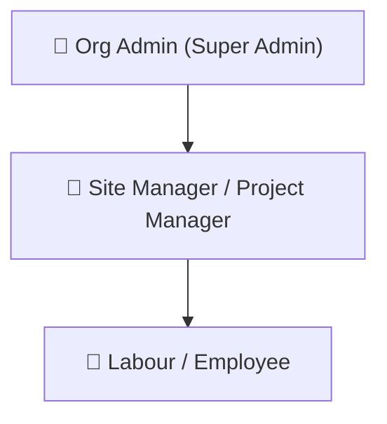

# BuildSphere: Role-Based Access Control (RBAC) Specification & Security Guide

This document defines the Role-Based Access Control (RBAC) architecture, module access boundaries, and operational permissions for the **BuildSphere Construction Management Platform**.

---

## 1. System Role Hierarchy

The platform categorizes users into three operational roles:



- **Tier 1 (Executive & Governance)**: Org Admin (`ORG_ADMIN`)
- **Tier 2 (Operational Leadership)**: Site Manager / Project Manager (`SITE_MANAGER`, `PROJECT_MANAGER`)
- **Tier 3 (Field Workforce)**: Labour / Employee (`employee/labour`)

---

## 2. Master Module Access Matrix

The table below outlines screen visibility and action capabilities across all platform modules:

| Platform Module | Org Admin | Site Manager / Project Manager | Labour / Employee |
| :--- | :---: | :---: | :---: |
| **Dashboard (KPIs & Telemetry)** | Full Access | Full Access | Hidden |
| **Projects Management** | Full (CRUD) | Full (Create/Edit) | Hidden |
| **Workforce & Employees** | Full (Manage/Wages) | Full (Manage/Assign) | Hidden |
| **Attendance Register & Reports** | Full (Mark/Edit/All) | Full (Mark/Edit/All) | **Personal View Only** |
| **Work Management (DPR & Tasks)** | Full Access | Full Access | Hidden |
| **Spend & Vendors** | Full (Approve & Log) | Full (Log & Bills) | Hidden |
| **Payment Central** | **Final Approval & Pay** | Request & View | Hidden |
| **Upad (Worker Advances)** | **Approve, Disburse, Delete** | Request & Record | **Personal View / Request** |
| **Payroll & Wages** | **Final Payout Release** | Compute & View | **Personal Payslips Only** |
| **Financial Ledger (GL)** | Full Access | Full Operational Access | Hidden |
| **Reports & Data Exports** | All Reports | Site & Operational Reports | Hidden |
| **Cost Estimator & BOQ** | Full Access | Full Access | Hidden |
| **Settings & Invitations** | **Exclusive Access** | Forbidden | Forbidden |
| **System Audit Logs** | **Exclusive Access** | Forbidden | Forbidden |

---

## 3. Granular Role Profiles

### 👑 Org Admin (`ORG_ADMIN`)
> **Note**: The Organization Administrator holds complete sovereignty over tenant data, user provisioning, and company-level financial disbursements.

* **Primary Capabilities:**
  * **Tenant Management**: Update organization profile, workday duration (e.g. 8.00 hrs), half-day thresholds (4.00 hrs), and overtime rules.
  * **Team Provisioning**: Invite users via email tokens, assign roles, deactivate accounts, and manage seat licenses.
  * **Financial Authority**: Exclusive authority to approve payments in **Payment Central**, disburse **Payroll**, and approve/delete **Upad advances**.
  * **Compliance & Auditing**: Review immutable system audit logs for forensic event tracking.
* **Access Scope**: Unrestricted across all platform modules.

---

### 👷 Site Manager / Project Manager (`SITE_MANAGER`, `PROJECT_MANAGER`)
> **Note**: Site Managers and Project Managers share operational authority over construction sites, personnel allocation, daily activity tracking, and expense logging.

* **Primary Capabilities:**
  * **Project Execution**: Create and edit project profiles, timelines, budgets, and client details.
  * **Workforce Deployment**: Add workers, configure daily wages, and assign personnel to specific project sites.
  * **Attendance Administration**: Mark daily attendance records (Full Day, Half Day, Overtime, Absent) and generate attendance summaries.
  * **DPR & Site Progress**: Record daily tasks, worker gang allocations, and progress percentages.
  * **Procurement Logging**: Log vendor invoices, site expenses, and daily running costs.
  * **Advance Requests**: Submit Upad requests on behalf of workers for admin settlement.
  * **Cost Estimation**: Run the AI Cost Estimator and generate client BOQ PDF quotations.
* **Restrictions:**
  * Cannot access **Organization Settings** or issue tenant team invitations.
  * Cannot perform final company bank account disbursements without Org Admin sign-off.

---

### 🦺 Labour / Employee (`employee/labour`)
> **Note**: The worker experience is streamlined for self-service transparency while safeguarding organizational finances.

* **Primary Capabilities:**
  * **Personal Attendance**: View total present days, full days, half days, and earned wages for the current cycle.
  * **Personal Upad**: Track advance history, approved amounts, and remaining outstanding balance.
  * **Personal Payslips**: View and verify salary disbursements and payment receipts.
* **Restrictions:**
  * Completely locked out of all administrative, financial, project management, and site modules.
  * Queries are strictly restricted to their own `employee_id`.

---

## 4. Valid Organization Sign-In Credentials

All roles are synchronized with the active tenant organization (**Pragti Construction**):

| Role | Name | Email | Password | Primary Module |
| :--- | :--- | :--- | :--- | :--- |
| **Org Admin** | Devesh Patel | `deveshpatel@gmail.com` | `password123` | Dashboard / Settings |
| **Site Manager / Project Mgr** | Viren Prajapati | `viren@gmail.com` | `password123` | Projects / Workforce |
| **Site Manager / Project Mgr** | Site Manager | `sitemanager@buildsphere.com` | `password123` | Attendance / DPR |
| **Labour / Employee** | Harshil | `harshil@gmail.com` | `password123` | Personal Attendance |

---

## 5. Security & Enforcement Architecture

### Backend Enforcement (`Django REST Framework`)
All API endpoints enforce tenant isolation and role permissions through custom decorators and permission classes:

```python
# backend/core/permissions.py
permission_classes = [IsAuthenticated, IsTenantUser, roles_required(Role.ORG_ADMIN, Role.PROJECT_MANAGER)]
```

1. **`IsTenantUser`**: Validates JWT authentication and confirms the user belongs to an active tenant organization (`organization_id`). Rejects requests without tenant binding.
2. **`roles_required(*roles)`**: Evaluates user role claims directly against backend enum definitions. Unauthorized attempts return HTTP `403 Forbidden`.
3. **Tenant Query Filtering**: All Django model queries inherit from `TenantModel`, auto-scoping queries to `filter(organization=request.user.organization)`.

### Frontend Guarding (`React + Tailwind`)
1. **Sidebar Navigation**: Nav items are filtered at render time using `navItems.filter(item => !item.roles || item.roles.includes(role))`.
2. **Route / Tab Shielding**: Unauthorized tabs redirect automatically to `DEFAULT_TAB_BY_ROLE[role]`.
3. **Action-Level Control**: Approval, delete, and payment buttons conditionally render only when matching role privileges are satisfied.
